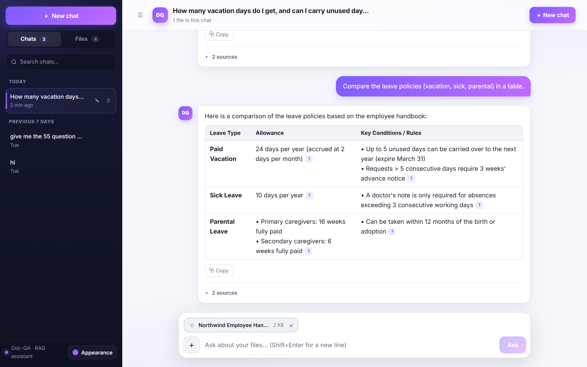
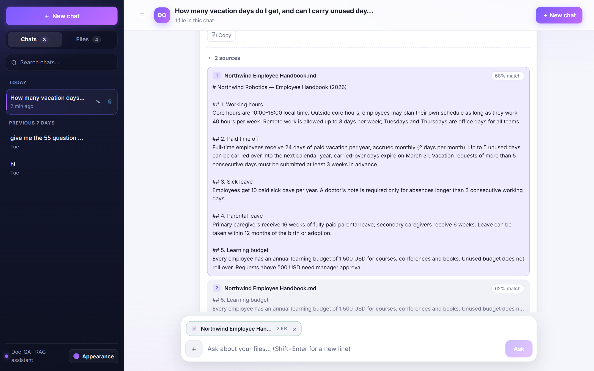
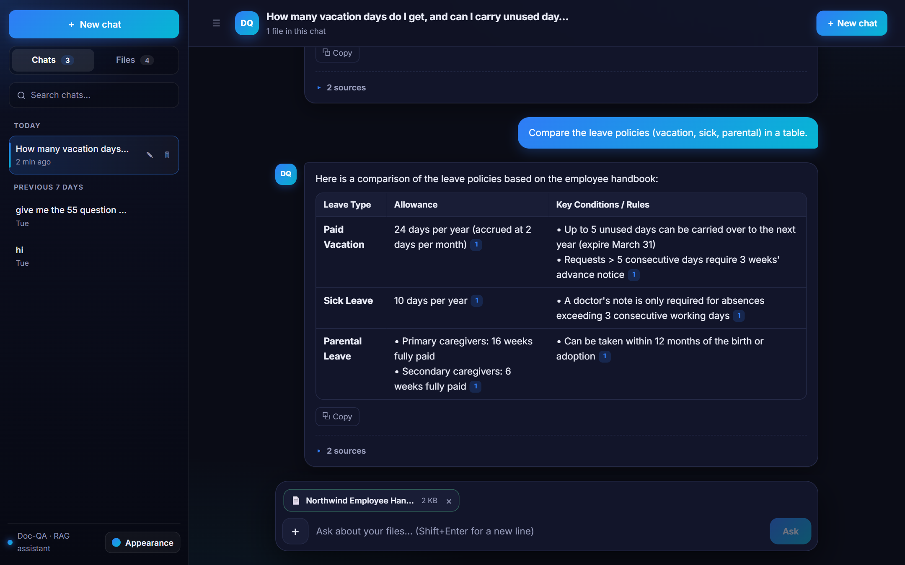
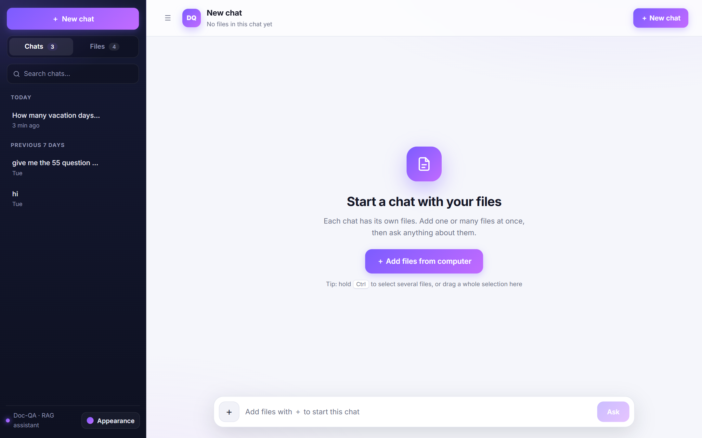
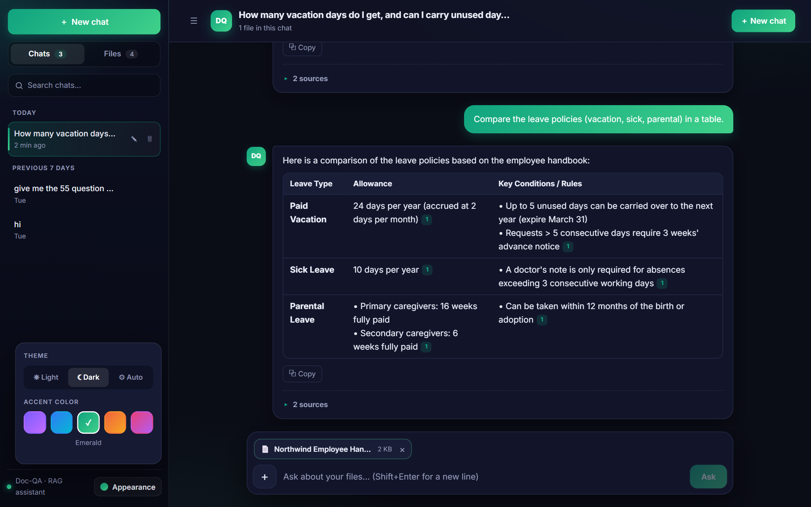
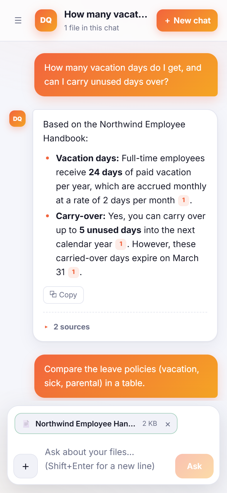
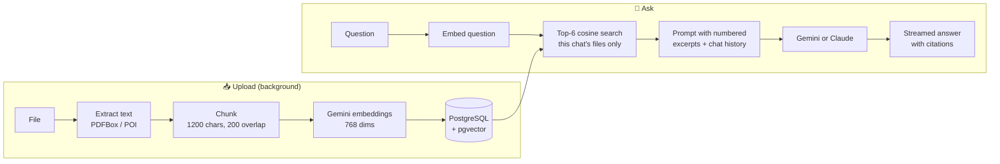

<div align="center">

# 📄 Doc-QA

**Chat with your documents.** Upload PDFs, Word files or text, ask questions in plain language, and get answers that cite the exact passages they came from.




</div>

---

## What it does

Doc-QA is a **RAG (retrieval-augmented generation)** assistant. When you add a file, it's split into chunks, each chunk is turned into a vector with Google Gemini embeddings, and the vectors are stored in PostgreSQL with **pgvector**. When you ask a question, the most relevant chunks are retrieved and handed to an LLM (Gemini by default, or Claude), which writes the answer and cites its sources as `[1]`, `[2]`, and so on.

- 💬 **Chats with their own files.** Each chat answers only from the files you added to it.
- 📎 **Multi-file upload.** Use the **＋** button, select several files with Ctrl, or drag and drop. Each file shows a progress bar.
- 🔎 **Clickable citations.** Every claim links to the source excerpt, with the file name, page and match score.
- ⚡ **Streaming answers.** Text appears as it's written, with a Stop button.
- 🗂️ **Saved history.** Chats are grouped by date and can be searched, renamed and deleted. Follow-up questions keep the conversation's context.
- 🎨 **Themes.** Light, Dark or Auto, with 5 accent colors. Works on phones too.
- 🛡️ **Resilient.** Timeouts, automatic model fallback, retries on rate limits, and recovery for uploads cut off by a restart.

## Screenshots

<table>
  <tr>
    <td width="50%"></td>
    <td width="50%"></td>
  </tr>
  <tr>
    <td align="center"><b>Citations</b>: click a <code>[n]</code> chip to see the exact passage</td>
    <td align="center"><b>Dark theme</b>, Ocean accent</td>
  </tr>
  <tr>
    <td width="50%"></td>
    <td width="50%"></td>
  </tr>
  <tr>
    <td align="center"><b>New chat</b>: each chat starts with its own files</td>
    <td align="center"><b>Appearance</b>: Light, Dark or Auto, plus 5 accent colors</td>
  </tr>
</table>

<p align="center">
  <br/>
  <b>Mobile</b>: the sidebar becomes a slide-out menu
</p>

## How it works



| Layer | Technology |
|---|---|
| Frontend | React 18, TypeScript, Vite, react-markdown |
| Backend | Spring Boot 3.5 (Java 21), REST plus Server-Sent Events, JdbcTemplate, Flyway |
| Database | PostgreSQL 17 + pgvector (HNSW cosine index), run in Docker |
| Embeddings | Google Gemini `gemini-embedding-001` |
| Answers | Gemini `gemini-flash-latest` by default, with `gemini-flash-lite-latest` as a fallback, or Claude `claude-opus-5-5` |
| Text extraction | Apache PDFBox (PDF), Apache POI (DOCX), plain text (TXT, MD, CSV, JSON, HTML, XML, LOG) |

## Quick start

### You need

- **Java 21+**: [Adoptium](https://adoptium.net)
- **Node.js 18+**: [nodejs.org](https://nodejs.org)
- **Docker Desktop**: [docker.com](https://www.docker.com/products/docker-desktop)
- **A free Gemini API key**: [aistudio.google.com/apikey](https://aistudio.google.com/apikey)

### Windows: one click

```powershell
git clone https://github.com/aashvin-30/doc-qa.git
cd doc-qa
start.bat
```

`start.bat` checks Java, Node, your API key and Docker. It then starts the database, backend and frontend, and opens **http://localhost:5173**. On the first run it asks for your Gemini key and saves it. To stop, run `stop.bat`; `stop-all.bat` also stops the database.

### Manual (any OS)

```bash
# 1. Database
docker compose up -d

# 2. Backend → http://localhost:8080
cd backend
export GEMINI_API_KEY=your-key          # PowerShell: $env:GEMINI_API_KEY="your-key"
./mvnw spring-boot:run                  # Windows: mvnw.cmd spring-boot:run

# 3. Frontend → http://localhost:5173  (in a second terminal)
cd frontend
npm install
npm run dev
```

> **Want Claude to write the answers?** Set `ANSWER_PROVIDER=claude` and `ANTHROPIC_API_KEY=sk-ant-...` before starting the backend. Embeddings still use Gemini.

## Configuration

Settings live in `backend/src/main/resources/application.yml`, and each one can be overridden with an environment variable.

| Variable / key | Default | What it does |
|---|---|---|
| `GEMINI_API_KEY` | (required) | Used for embeddings, and for answers when the provider is Gemini |
| `ANSWER_PROVIDER` | `gemini` | `gemini` or `claude` |
| `ANTHROPIC_API_KEY` | (none) | Needed only when `ANSWER_PROVIDER=claude` |
| `GEMINI_CHAT_MODEL` | `gemini-flash-latest` | The model that writes answers |
| `GEMINI_FALLBACK_MODELS` | `gemini-flash-lite-latest` | Used when the main model is busy. A failing model is skipped for 5 minutes. |
| `DB_URL` / `DB_USER` / `DB_PASSWORD` | `localhost:5432/docqa`, `docqa` / `docqa` | Database connection |
| `app.retrieval.top-k` / `min-similarity` | `6` / `0.35` | How many excerpts are retrieved, and the minimum match score |
| `app.chunking.chunk-size` / `chunk-overlap` | `1200` / `200` | Chunk size and overlap, in characters |
| `CORS_ORIGINS` / `VITE_API_BASE` | (dev proxy) | For deploying the frontend and backend separately |

The maximum upload size is 25 MB per file.

## REST API

| Method | Path | Description |
|---|---|---|
| `POST` | `/api/documents?conversationId=` | Upload a file (multipart field `file`), optionally attaching it to a chat. Returns `202`. |
| `GET` | `/api/documents` | List files, most recently used first |
| `GET` / `DELETE` | `/api/documents/{id}` | Get a file's status, or delete the file and its chunks |
| `GET` / `POST` | `/api/conversations` | List chats / create an empty chat |
| `GET` / `PATCH` / `DELETE` | `/api/conversations/{id}` | Get a chat with its messages and files / rename it / delete it |
| `POST` | `/api/conversations/{id}/documents` | Attach an existing file with `{documentId}` |
| `DELETE` | `/api/conversations/{id}/documents/{docId}` | Remove a file from a chat (the file stays in your library) |
| `POST` | `/api/chat/stream` | Ask a question with `{question, conversationId?}`. Returns an SSE stream of `conversation`, `sources`, `delta`, `done` and `error` events. |
| `POST` | `/api/chat/ask` | The same request, non-streaming. Returns `{conversationId, answer, sources}`. |
| `GET` | `/actuator/health` | Health check |

```bash
curl -F file=@handbook.pdf http://localhost:8080/api/documents
curl -N -X POST http://localhost:8080/api/chat/stream \
  -H "Content-Type: application/json" \
  -d '{"question":"How many vacation days do I get?"}'
```

## Project structure

```
doc-qa/
├── backend/                     Spring Boot app
│   └── src/main/java/com/docqa/
│       ├── config/              settings, CORS, thread pools, HTTP clients
│       ├── document/            upload / list / delete files
│       ├── ingest/              text extraction, chunking, background indexing
│       ├── embedding/           Gemini embedding client
│       ├── retrieval/           pgvector storage and similarity search
│       ├── conversation/        saved chats and their files
│       └── chat/                RAG prompt, Gemini / Claude answer generators, SSE
│   └── src/main/resources/db/migration/   Flyway SQL (V1–V3)
├── frontend/                    React + Vite app
│   └── src/
│       ├── components/          Sidebar, ChatPanel, MessageBubble, Appearance
│       ├── api.ts               REST, upload progress and SSE client
│       └── styles.css           "Aurora" theme
├── docs/wiki/                   full documentation
├── docs/screenshots/            images used in the docs
├── docker-compose.yml           PostgreSQL 17 + pgvector
├── start.bat / stop.bat         one-click launchers for Windows
└── PROJECT_REPORT.md            full project report
```

## Roadmap

- [ ] Hybrid search (pgvector plus PostgreSQL full-text) with re-ranking
- [ ] OCR for scanned PDFs
- [ ] User accounts and per-user data
- [ ] Dockerfiles, so the whole app starts with `docker compose up`
- [ ] End-to-end tests in CI

## More details

- 📚 **[Documentation wiki](docs/wiki/README.md)**: the [User Guide](docs/wiki/User-Guide.md), [Architecture](docs/wiki/Architecture.md), [Configuration](docs/wiki/Configuration.md), [REST API](docs/wiki/REST-API.md), [Database](docs/wiki/Database.md), [Development](docs/wiki/Development.md), [Troubleshooting](docs/wiki/Troubleshooting.md) and [FAQ](docs/wiki/FAQ.md)
- 📝 **[PROJECT_REPORT.md](PROJECT_REPORT.md)**: the architecture, data model, test results and design decisions

---

<div align="center">
Built by <a href="https://github.com/aashvin-30">aashvin-30</a> with Spring Boot, React, pgvector and Gemini.
</div>
