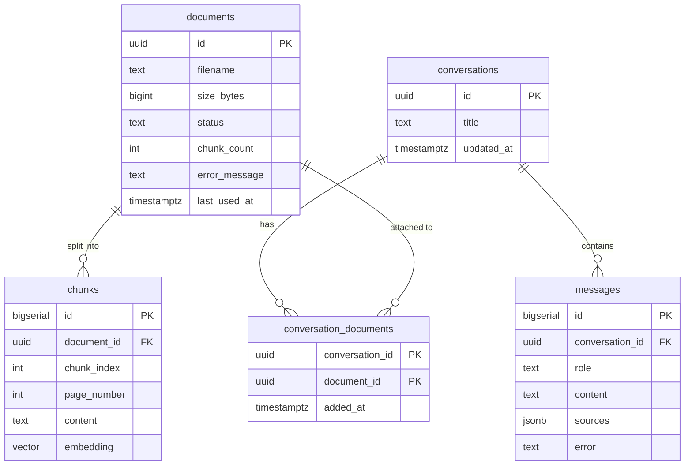

# Database

PostgreSQL 17 with the **pgvector** extension runs in Docker (image `pgvector/pgvector:pg17`, container `docqa-postgres`, volume `docqa-pgdata`). Flyway creates and upgrades the schema when the backend starts.



## Migrations

| File | What it adds |
|---|---|
| `V1__init.sql` | The `vector` extension, `documents`, and `chunks` with `embedding vector(768)` and an **HNSW** index (`vector_cosine_ops`) |
| `V2__conversations.sql` | `conversations` and `messages` (sources stored as JSONB), plus `documents.last_used_at` |
| `V3__conversation_documents.sql` | `conversation_documents`, which links files to chats |

All foreign keys use `ON DELETE CASCADE`. Deleting a document removes its chunks and chat links. Deleting a chat removes its messages and links, but not the files.

## The similarity search

pgvector's `<=>` operator is cosine distance, so similarity = `1 - distance`. The query is restricted to the chat's files, ordered by distance (which uses the HNSW index), and limited to `top-k` (6). Results with a similarity below `min-similarity` (0.35) are discarded.

```sql
SELECT c.content, c.page_number, d.filename,
       1 - (c.embedding <=> :query) AS similarity
FROM chunks c
JOIN documents d ON d.id = c.document_id
WHERE c.document_id = ANY(:chatFileIds)
ORDER BY c.embedding <=> :query
LIMIT 6;
```

## Handy commands

```bash
docker compose up -d                          # start
docker compose logs postgres                  # logs
docker exec -it docqa-postgres psql -U docqa  # SQL shell
docker compose down                           # stop (data kept)
docker compose down -v                        # stop and DELETE all data
```
