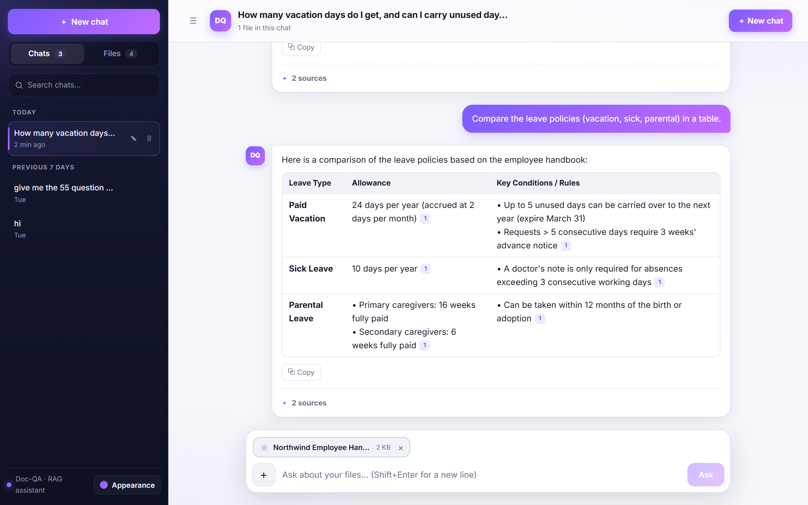

# Doc-QA Wiki

**Doc-QA** is a RAG (retrieval-augmented generation) assistant for asking questions about your own documents. You upload PDFs, Word files or text files to a chat, ask questions in plain language, and get streamed answers with numbered citations that point to the exact passages used.

It's built with **Spring Boot 3.5 (Java 21)**, **React 18 + TypeScript**, **PostgreSQL 17 + pgvector**, **Google Gemini** (embeddings and answers) and, optionally, **Anthropic Claude** (answers).

## Start here

| Page | What's in it |
|---|---|
| [Getting Started](Getting-Started.md) | Install the requirements and run the app in a few minutes |
| [User Guide](User-Guide.md) | Chats, files, citations and themes, with screenshots |
| [Architecture](Architecture.md) | How ingestion, retrieval and answer generation work |
| [Configuration](Configuration.md) | Every setting and environment variable |
| [REST API](REST-API.md) | Endpoints, request and response shapes, SSE events |
| [Database](Database.md) | Tables, indexes and migrations |
| [Development](Development.md) | Project structure, tests, and how to extend the app |
| [Troubleshooting](Troubleshooting.md) | Common problems and how to fix them |
| [FAQ](FAQ.md) | Short answers to common questions |

## Features at a glance

- 💬 Chats that each keep **their own files** and answer only from them
- 📎 **Multi-file upload** with progress bars and drag and drop
- 🔎 **Clickable citations** showing the source excerpt, page and match score
- ⚡ **Streaming answers** with a Stop button
- 🗂️ **Saved chat history**: search, rename, delete, and follow-up questions
- 🎨 **Light, Dark and Auto themes** with 5 accent colors, on desktop and mobile
- 🛡️ Timeouts, **model fallback**, rate-limit retries, and crash recovery

Source code: https://github.com/aashvin-30/doc-qa
