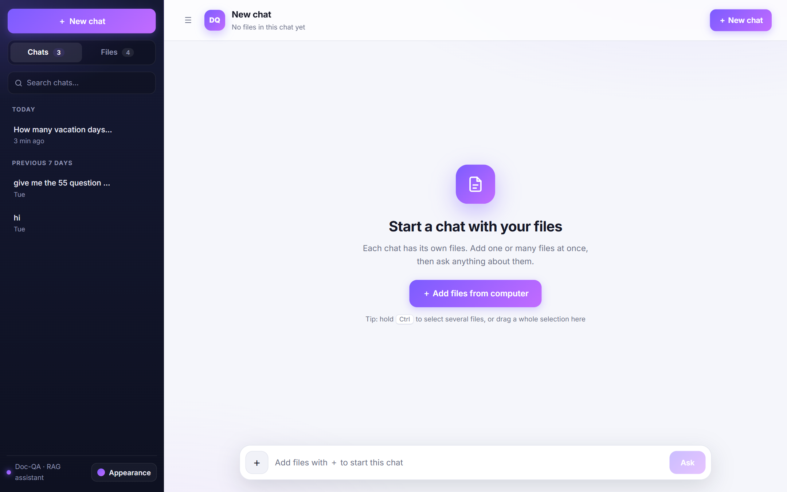
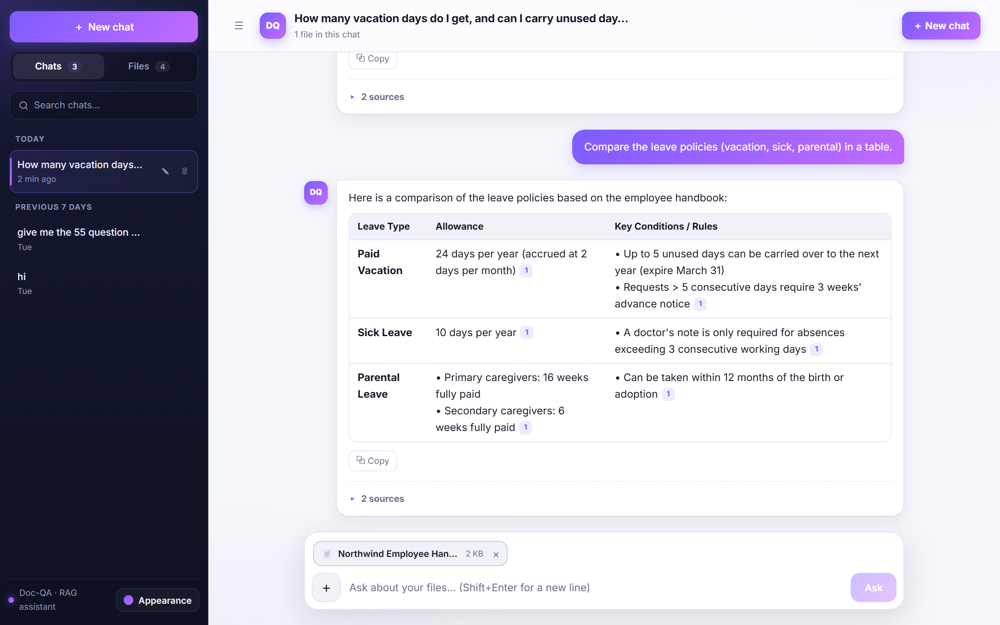
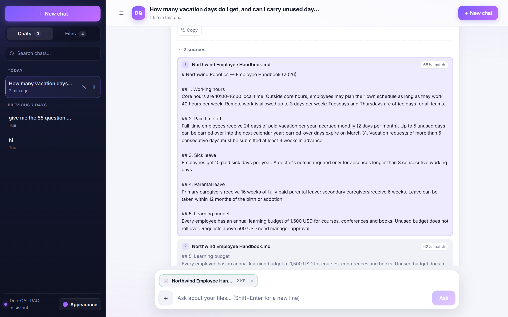
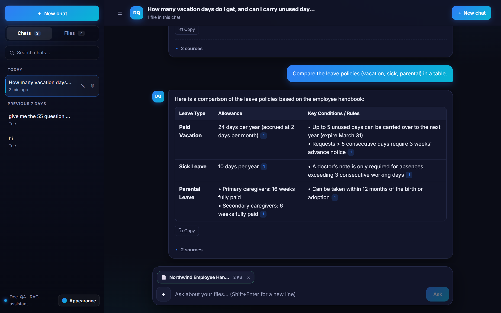
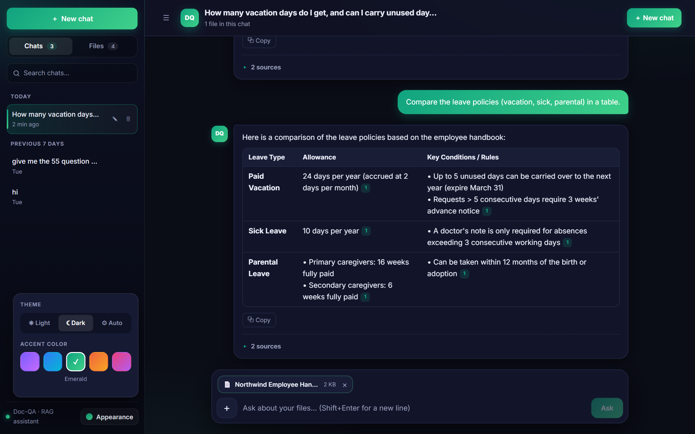
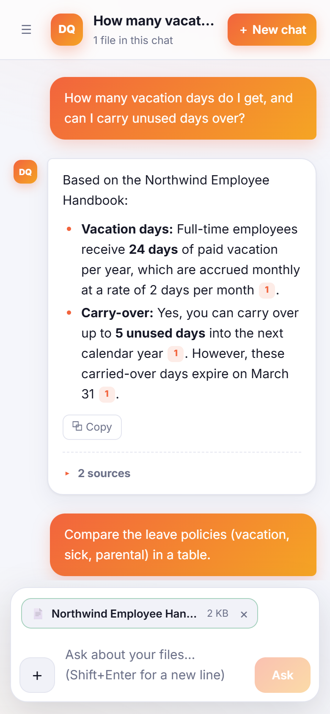

# User Guide

## Starting a chat

Click **＋ New chat**. Each chat starts empty and has **its own files**: a chat answers only from the files added to it.

## Adding files

- Click **＋ Add files from computer**, or the **＋** button next to the message box.
- To add several files, hold **Ctrl** while selecting them, or drag them onto the chat.
- Up to 3 files upload at the same time, each with a progress bar.
- To reuse a file you uploaded before, open the **＋** menu and choose it under **Add from your files**, or go to the **Files** tab and click **＋** next to the file.

**Supported types:** PDF, DOCX, TXT, MD, CSV, JSON, HTML/HTM, XML and LOG, up to **25 MB** each. Unsupported or oversized files are flagged before they upload.

Each file in the chat shows a status chip:

| Chip | Meaning |
|---|---|
| Uploading 42% | The file is being sent to the server |
| Indexing… | The text is being extracted, chunked and embedded |
| Ready | The file can be used in answers |
| Failed | Hover over the chip to see why |

Click **×** on a chip to remove the file from this chat. The file stays in your library.

## Asking questions

Type a question and press **Enter**. Use **Shift+Enter** for a new line. The answer streams in as it's written, and **Stop** cancels it. Follow-up questions such as "what about those?" use the earlier messages in the chat.

## Citations

Small numbers like **1** in an answer are citations. Click one to open the **sources** list with the matching passage highlighted. Each source shows the file name, page (for PDFs) and match score.

The **Copy** button copies the answer as Markdown.

## Managing chats

- Chats are grouped by **Today**, **Yesterday**, **Previous 7 days** and **Older**.
- Use **Search chats…** to filter them by title.
- ✏️ renames a chat (or double-click its title), and 🗑 deletes it.
- A chat's title comes from its first question.

## Files tab

The **Files** tab lists every uploaded file, most recently used first. **✓ In chat** marks files in the open chat. You can add a file to the open chat, or delete it everywhere.

## Appearance

Click **Appearance** at the bottom of the sidebar to choose **Light**, **Dark** or **Auto** (follows your system setting) and one of 5 accent colors: Violet, Ocean, Emerald, Sunset or Rose. Your choice is remembered in this browser.

| Dark + Ocean | Appearance panel |
|---|---|
|  |  |

## On a phone

On narrow screens, the sidebar becomes a slide-out menu (☰).

